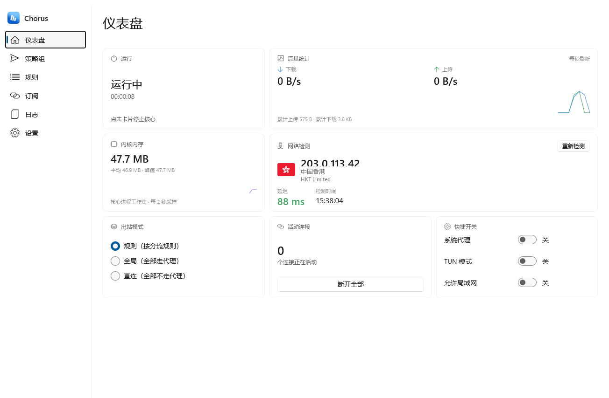
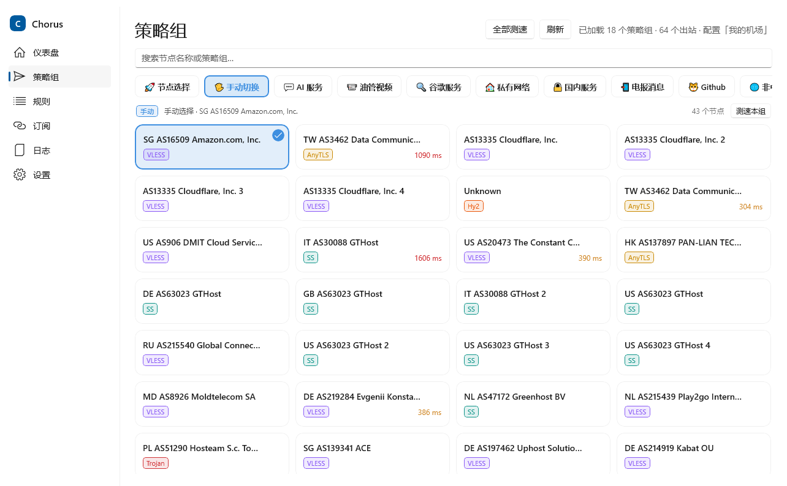
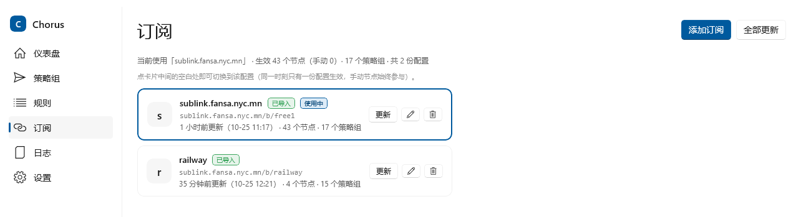
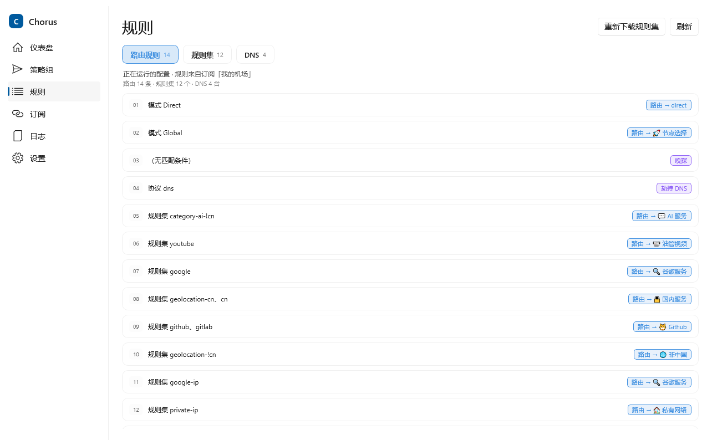
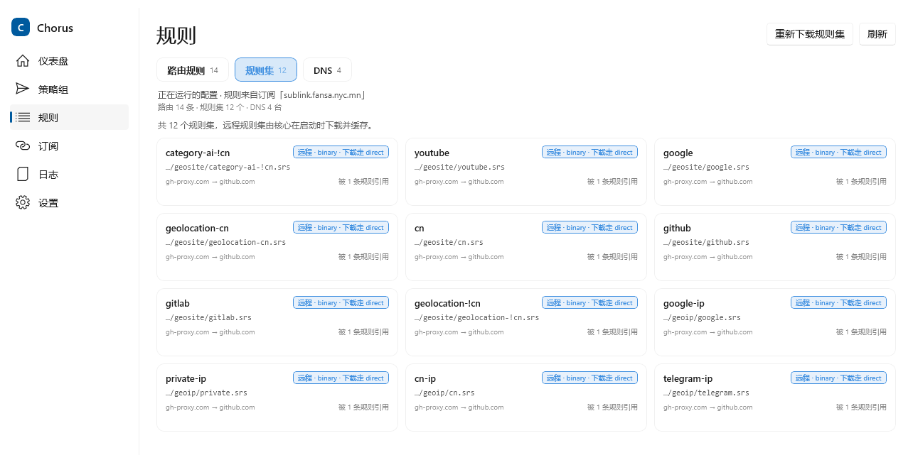
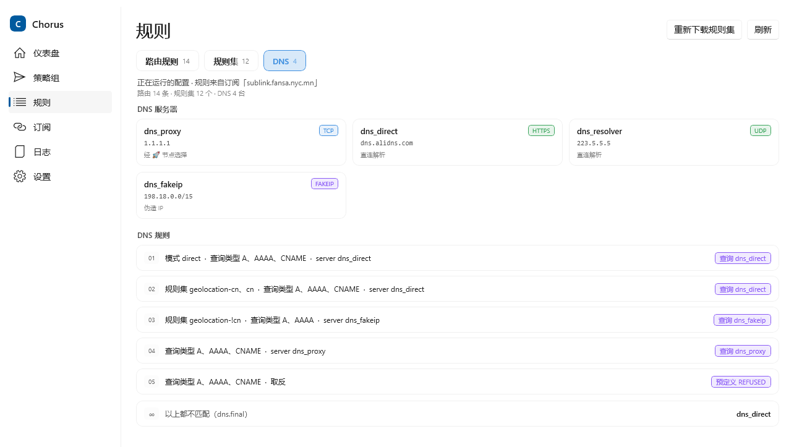
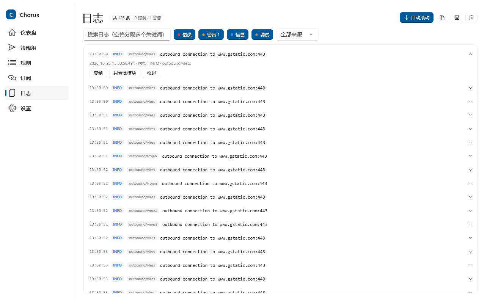
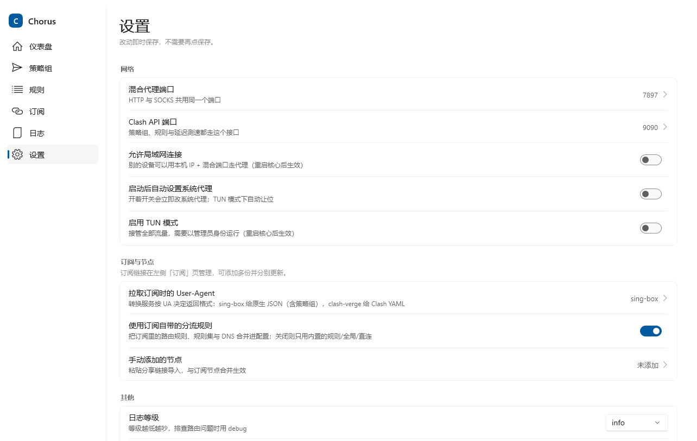

# Chorus（合唱）

一个 Windows 原生的 [sing-box](https://sing-box.sagernet.org/) 图形客户端，使用 **WinUI 3 / C# / .NET 10** 构建。

[](https://github.com/fansa92/Chorus/actions/workflows/ci.yml)
[](https://github.com/fansa92/Chorus/releases)
[](LICENSE)

> 名字由来：sing-box 的 **sing** → 一组节点像合唱团（chorus）一样协同工作。

核心思路：GUI 不实现代理协议，只做三件事 —— **生成配置、管理 sing-box.exe 进程、消费 Clash API**（流量、策略组切换、测速）。编译全部交给 GitHub Actions，本地只写代码和跑单元测试。

## 界面

界面布局参考 [Bettbox](https://github.com/fanx-dev/Bettbox)：左侧导航 + 卡片式内容区。应用图标同样是圆角方形瓦片式的 WinUI 风格（渐变底 + 白色图形），任务栏、托盘和侧栏共用同一套视觉。

**仪表盘** —— 运行开关（显示运行时长）、流量统计（实时上下行 + 走势曲线 + 累计流量）、内核内存（工作集均值/峰值 + 走势）、网络检测（出口国家的国旗 + IP / 地区 / 运营商 / 延迟）、出站模式、活动连接（含一键断开）、快捷开关。


**策略组** —— 每个策略组一个标签页，组内节点自适应阵列排布；支持搜索、单组/全部测速、点击切换节点，节点上直接显示协议与延迟。


**订阅** —— 多订阅管理，点卡片即可切换「当前使用的配置」（Bettbox 的 profile 语义），卡片上带状态徽标、相对更新时间、节点与策略组数量。


**规则** —— 三标签展示真正生成进 `config.json` 的路由规则、规则集与 DNS；条件翻成中文，点行展开原始 JSON。

路由规则：


规则集（远程 `.srs`，支持一键清缓存重下）：


DNS 服务器与 DNS 规则：


**日志** —— 核心 stdout 与应用日志合并展示，按来源/级别/模块筛选、关键词搜索，点行展开可看详情、复制、只看此模块。


**设置** —— 分组卡片 + 行式条目，改一项存一项（没有「保存」按钮）：端口、局域网、TUN、系统代理、订阅 UA、是否启用订阅自带的分流规则、日志等级、托盘行为。


## 功能

**核心**

- 启动 / 停止 sing-box 核心，启动前自动 `sing-box check` 校验配置
- 内置 `--start` 参数：带该参数启动时自动拉起核心（开机自启 / 脚本化启动用）
- 托盘图标：关闭到托盘、托盘退出、单实例

**界面**

- 左侧导航：仪表盘 / 策略组 / 规则 / 订阅 / 日志 / 设置
- 仪表盘卡片：运行开关（显示运行时长）、**流量统计**（实时上传/下载速度 + 曲线 + 累计流量，一张卡说完）、**内核内存**（核心进程工作集，每 2 秒采样，给均值与峰值 + 走势）、**网络检测**（经当前代理端口测出口 IP / 地区 / 运营商 / 延迟，并按国家代码显示国旗，可一键重测）、出站模式（规则 / 全局 / 直连，经 Clash API 实时切换）、活动连接（含一键断开全部）、快捷开关（系统代理 / TUN / 允许局域网）
- 提示条（信息 / 警告 / 错误）几秒后自动消失（4 / 6 / 8 秒），也可以手动关掉
- 策略组：**每个策略组一个切换标签，组内节点阵列式排布**；按名称搜索、单组测速、全部测速、点击节点切换
- 日志页：250ms 合批渲染；来源（核心 / 应用）、级别、模块三类筛选 + 关键词搜索（空格分隔多个条件 AND）；点行展开看原始负载，可复制 / 只看此模块 / 导出；自动滚动可关，翻上去看历史时不会被打断
- 规则页：路由规则 / 规则集 / DNS 三个标签，从**实际生成的配置**解析，条件翻中文，可展开原始 JSON；规则集支持一键清缓存重新下载

**订阅**

- 多订阅管理：添加 / 更新 / 全部更新 / 编辑 / 删除（删除有二次确认），每个订阅独立保存节点与更新状态
- **选择当前使用的配置**：点卡片即切换，只有选中的那份参与生成配置（节点、策略组、以及它自带的 route/dns 都跟着换），手动节点始终附加；未选择时退回「全部合并」的旧行为
- 订阅自带的 `route` / `dns`（含远程规则集）会合并进生成的配置：校验出站与规则集引用、剔除悬空项、修好 `dns.final` 与 `route.default_domain_resolver`，去掉订阅里的 `clash_mode` 内置规则避免与 Chorus 自己的冲突
- 支持手动粘贴分享链接（`ss` / `vmess` / `vless` / `trojan` / `hysteria2` / `anytls`）与 sing-box 原生 JSON 订阅
- 拉取 UA 可配置（默认 `sing-box`，订阅转换服务据此返回 sing-box JSON 或 Clash YAML）
- 拉取容错链：**核心代理 → 多 DNS 取并集 + IP 竞速 → 普通直连兜底**。竞速会并发查询系统 DNS 与 223.5.5.5 / 119.29.29.29 / 9.9.9.9 / 8.8.8.8，合并去重后对每个 IP 并发做 TCP（HTTPS 则带 SNI 做 TLS 握手）探测，取最快可用的那个并用 `SocketsHttpHandler.ConnectCallback` 钉住 IP 请求（SNI / 证书校验照常，规避 DNS 污染与部分 CDN 边缘 IP 被墙）

**策略组**

- sing-box JSON 订阅里的 `selector` / `urltest` 策略组自动导入；仪表盘默认生成「🚀 节点选择」（手动）与「♻️ 自动选择」（urltest）
- 用户可在 JSON 中自定义策略组，支持：
  - 精确引用节点名
  - **嵌套引用其他策略组（在组里选择「节点组」）**
  - `"*"` 展开为全部节点
  - 通配符按节点名筛选（如 `*香港*`）

**系统集成**

- 系统代理一键开关（写注册表 + WinINET 广播立即生效，仪表盘实时切换）
- TUN 模式（配置开关，需管理员运行）
- 实时上/下行流量（Clash API WebSocket `/traffic`），累计流量按会话统计
- 内核内存：读核心进程工作集（每 2 秒），界面给出当前值、均值与峰值
- 网络检测：走当前代理端口探测出口 IP / 地区 / 运营商并测一次 HTTP 延迟；卡片左侧按出口国家显示国旗（271 面，本地资源、离线可用），查不到归属时退回地球图标；代理链路不通时自动直连兜底并在卡片上标注

## 技术栈

| 层 | 选型 |
| --- | --- |
| 运行时 | .NET 10（`net10.0-windows10.0.19041.0`） |
| UI | WinUI 3 / Windows App SDK 1.8 |
| MVVM | CommunityToolkit.Mvvm 8.4 |
| 托盘 | H.NotifyIcon.WinUI |
| 核心 | sing-box ≥ 1.12（CI 打包最新稳定版，位于 `core\sing-box.exe`） |
| 测试 | xUnit（106 个用例，`Chorus.Core` 跨平台可跑） |

## 目录结构

```
Chorus/
├─ .github/workflows/        # CI：单元测试 + 编译发布；Release：打 tag 出 Release
├─ docs/screenshots/         # README 用的界面截图
├─ src/
│  ├─ Chorus.Core/           # 纯 .NET 逻辑库（可跨平台单测）
│  │  ├─ Models/             # NodeEntry / ProxyGroup / AppSettings / SubscriptionEntry
│  │  ├─ Parsing/            # 分享链接、订阅解析、订阅 route/dns 抽取、核心日志清洗
│  │  ├─ Configuration/      # ConfigGenerator、RoutingMerger、ConfigInspector
│  │  ├─ Net/                # 最小 DNS 查询、多 DNS 并集 + IP 竞速
│  │  ├─ ClashApi/           # Clash API 客户端（HTTP + WebSocket）
│  │  ├─ Interop/            # Job Object（随宿主退出杀核心）
│  │  └─ ...                 # 进程管理、系统代理、订阅下载
│  └─ Chorus.App/            # WinUI 3 应用
│     ├─ Views/              # 六个页面 + 主窗口
│     ├─ ViewModels/
│     └─ Services/           # AppServices、AppRunner（核心生命周期）
├─ tests/Chorus.Core.Tests/  # xUnit 单元测试
└─ scripts/make-icon.ps1     # 重新生成占位图标
```

## 开发工作流

1. **写代码**：逻辑放 `Chorus.Core`，UI 放 `Chorus.App`。
2. **本地跑测试**（需要 .NET 10 SDK）：
   ```bash
   dotnet test tests/Chorus.Core.Tests/Chorus.Core.Tests.csproj -c Release
   ```
3. **推送**，GitHub Actions 自动完成单元测试 + `dotnet publish`（win-x64 自包含）并在 Artifact 中给出 `Chorus-win-x64.zip`。
4. **本地出包**（可选，需要 Windows + .NET 10 SDK）：
   ```bash
   dotnet publish src/Chorus.App/Chorus.App.csproj -c Release -r win-x64 \
     --self-contained true -p:PublishSingleFile=false -p:Platform=x64 -o dist/app
   # publish 不会带上核心，记得把 sing-box.exe 放到 dist/app/core/
   ```
5. **发版**：推 tag 触发 Release 工作流：
   ```bash
   git tag v0.1.3 && git push origin v0.1.3
   ```

## 用户使用说明

1. 从 [Releases](https://github.com/fansa92/Chorus/releases) 下载并解压 `Chorus-win-x64.zip`（**已内置官方 sing-box 核心**，位于 `core\sing-box.exe`，构建时自动打包最新稳定版）。
2. 启动应用 → 侧边栏「订阅」页添加订阅链接（支持多个，点卡片可切换当前使用的配置）→ 仪表盘打开开关。
3. **首次运行是干净的**：安装包里不带任何订阅链接，`系统代理` / `TUN` / `允许局域网` 全部默认关闭，代理只在你手动打开开关后才生效。
4. 也可以在设置页手动粘贴分享链接补充节点；手动节点会附加到当前选中的订阅上。
5. 设置与节点保存在 `%LOCALAPPDATA%\Chorus\settings.json`（**不在安装目录里**，升级/换包不会把订阅信息带进发布包；卸载时删掉该目录即可清干净），日志在 `%LOCALAPPDATA%\Chorus\crash.log`（异常才写）。
6. 想换核心版本：替换 `core\sing-box.exe`，或把新版放到 `%LOCALAPPDATA%\Chorus\core\`（优先读便携目录）。
   注意：应用要求 sing-box **1.12 或更高版本**（配置使用新版 DNS 服务器格式；CI 打包时自动下载最新稳定版）。

### 自定义策略组

编辑 `settings.json` 的 `Profile.Groups`（名称不要用两个内置组的名字）：

```json
"Profile": {
  "Nodes": [],
  "Groups": [
    { "Name": "🇭🇰 香港",  "Type": "selector", "Members": ["*香港*", "*HK*"] },
    { "Name": "🇺🇸 美国",  "Type": "urltest",  "Members": ["*US*"] },
    { "Name": "出口",      "Type": "selector", "Members": ["🇭🇰 香港", "🇺🇸 美国", "♻️ 自动选择"] }
  ]
}
```

- `Type`：`selector`（手动选择）/ `urltest`（按延迟自动）
- `Members` 里写 **精确节点名**、**组名**（组里可以再选组）、`"*"` 或 **通配符**
- 组之间不要互相循环引用（sing-box 校验会拒绝）；不要引用「🚀 节点选择」

### TUN 模式

TUN 需要管理员权限。当前版本请以管理员身份运行应用后启用；正规提权方案（helper 进程 / Windows 服务）在路线图中。

## 已知限制

- 应用异常退出时系统代理可能残留，可在 Windows 设置中手动关闭，或重启本应用再退出
- 订阅域名落在被封锁的 CDN 边缘 IP 段时，竞速也可能找不到可用 IP，提示里会给出实际尝试的地址与候选数量
- 远程规则集由核心在启动时下载，冷启动可能要几十秒，期间策略组页会显示「正在等待核心就绪…」

## 路线图

- [ ] 核心自动下载/更新（GitHub Releases）；断网检测
- [ ] 连接管理页（Clash API `/connections`）
- [ ] 策略组 UI 编辑器（当前是 JSON）；订阅自动更新定时器
- [ ] TUN 提权服务模式；MSIX 打包

## License

MIT
